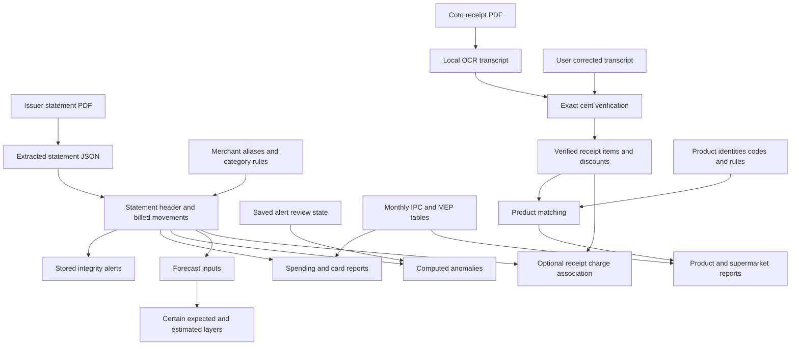

# Current data relationships and workflows

The application joins issuer evidence, supermarket evidence, human classification decisions, and reference valuation series. Most reports are derived from these sources; there is currently no balanced journal connecting them to asset and liability accounts.

## Information flow

The association at the bottom connects two descriptions of one purchase. It does not merge their records or add a second expense. Forecast layers are derived expectations, and issuer closing balances are point-in-time totals; neither is another purchase list.

## Stored facts, decisions, and derived outputs

Source: [schema](../../web/src/lib/db.ts), [ingestion](../../web/src/lib/ingest.ts), [receipt storage](../../web/src/lib/receipts/ingest.ts), [reference paths](../../web/src/lib/paths.ts).

| Information | Current persistence and relationship | Meaning for a replacement |
| --- | --- | --- |
| Statement source | Original PDF under `pdfs/`; extracted document under `json/` | Retain access to issuer evidence and extraction provenance |
| Statement header | `statements`: brand, dates, cycle month, ARS/USD closing balances, minimum payment, prior ARS balance, purchase limit, ARS financing rates | Keep balance/term facts distinct from movement-derived spending |
| Billed movements | `transactions` belongs to one statement; source section/date/description, ARS/USD, installment position/count, derived merchant/category, fingerprint | Separate original evidence from naming/categorization decisions and future journal representation |
| Forward installment schedule | `upcoming_installments` belongs to one statement, keyed by month | Keep source schedule identity and supersession; do not sum every historical schedule |
| Integrity discrepancies | `alerts` belongs to one statement | Recreated on statement replacement |
| Investigation decisions | `alert_reviews`, keyed by derived alert identity, no statement foreign key | Can survive row rebuilds; current stale cleanup loses past decisions for vanished alerts |
| Merchant classifications | Ordered `category_rules`, `category_proposals`, `rejected_merchants`, and `merchant_aliases` | Persist rule priority, accepted/rejected proposals, and raw/sent proposal names |
| Verified supermarket purchase | `receipts`: fiscal number, hash, path, dates, location/payment/fiscal metadata, totals, verification, transcript provenance | Receipt identity and verification are independent of card charge identity |
| Purchase detail | `receipt_items` belongs to receipt; `receipt_discounts` belongs to item; preserve item/discount order | Keep quantities, units, printed identifiers, signed discounts, gross and net amounts |
| Transcription evidence | `receipt_transcripts` stores OCR and optional corrected transcript for a receipt | Keep both original extraction and accepted correction |
| Product catalog | `products`, chain/article `product_codes`, ordered description `product_rules`, and per-item `product_matches` | Product identity and curation are independent of item evidence; current matches carry code/rule/auto provenance |
| Evidence association | `receipt_charge_links`: unique receipt and unique charge fingerprint, automatic/manual method and creation time | Current relationship is one receipt to one charge; no split-payment/multi-receipt allocation model |
| Reference valuation | `data/ipc.json`, `data/mep.json` | Mutable monthly reporting inputs, not frozen settlement rates |
| Computed output | Most spending reports, detected recurring charges, anomalies, forecasts, receipt analytics | Recomputable from source facts, decisions, and references; current derived results are not an accounting audit trail |

SQLite runs locally with WAL and foreign-key enforcement. Opening the application database can create/widen tables, backfill charge fingerprints, and seed empty rule/catalog tables. A read-only discovery tool should not call `getDb()` merely to inspect data. This baseline was derived without opening the private database.

The extracted statement JSON retains information not copied into reporting tables: account/cardholder/product, additional period/rate/limit/summary fields, purchase block/cardholder/voucher/raw-line details, and declared totals, where provided by the parser. PDFs/JSON matter for a future migration; the current reporting database is not a lossless copy of every source field.

## Statement import and replacement

Sources: [upload handler](../../web/src/app/api/upload/route.ts), [upload pipeline](../../web/src/lib/upload.ts), [issuer parser](../../scripts/pdf_to_json.py), [Mercado Pago parser](../../scripts/mp_statement.py), [row ingestion](../../web/src/lib/ingest.ts).

1. The user uploads a PDF through `/upload`. Filename validation accepts a constrained flat PDF name; byte signature and a **10 MiB** limit are checked.
2. The app writes a temporary PDF, then invokes the configured local Python environment. Parsing has a 120-second timeout and specific setup/layout/read failure messages. PDF parsing is local; this path does not use the merchant classification API.
3. Layout detection chooses the BBVA Visa/Mastercard parser or Mercado Pago parser. Mercado Pago requires a year in the filename because the supported document layout omits it. Unknown or inconsistent layouts are rejected instead of treated as generic statements.
4. Parsed JSON feeds statement conversion. Merchant naming and categorization are derived using current ordered rules; integrity alerts and stable charge fingerprints are computed.
5. Within a database transaction, delete the prior statement matching **filename OR (brand + closing date)**, with dependent transactions, schedules, and alerts, then insert the replacement.
6. Retry automatic linking for unlinked receipts. The upload pipeline installs final PDF/JSON names. When replacement uses a different filename, the old JSON is removed and old PDF moved to `.superseded/`. Same-name success overwrites the final document rather than retaining version history.
7. Show statement counts, replacement details, alerts, and an IPC-staleness warning when the imported cycle exceeds reference coverage.

The database transaction and filesystem renames are separate. There is no single transaction covering every upload stage, reference lookup, and receipt-linking side effect. A future system's import guarantees need an explicit decision rather than assuming complete atomicity today.

The [bulk ingest command](../../web/scripts/ingest.ts) reads sorted JSON files from the repository's `json/`, imports each with current rules, and reports surviving statements. It is not a merge of independent ledgers. It also does not use the upload helper's JSON-directory override.

### Current identities and their limits

- Statement brand serves as the card grouping, including `visa`, `mastercard`, and `mercadopago`. There is no explicit issuer/account/card entity. Two accounts sharing a brand and closing date can overwrite each other under the current replacement rule.
- [Charge fingerprints](../../web/src/lib/fingerprint.ts) use brand, printed date and description, ARS/USD values, installment position/count, and an ordinal for otherwise identical rows within a statement. Merchant/category edits leave the fingerprint unchanged; source corrections can change it.
- Fingerprints omit statement closing date and explicit account identity. Identical lines on separate statements can collide. Receipt links deliberately have no foreign key to transient transaction IDs, so a changed/disappeared charge can leave a stored link without a live join.
- Reimport preserves useful identity only while the underlying identity fields stay compatible. These are current limitations to resolve, rather than keys a new implementation must reuse.

## Merchant correction and optional AI assistance

Sources: [normalization and categories](../../web/src/lib/categorize.ts), [alias rules](../../web/src/lib/aliases.ts), [stored rule data](../../web/src/lib/rules.ts), [review actions](../../web/src/app/review/actions.ts), [manual corrections](../../web/src/app/categories/actions.ts), [LLM boundary](../../web/src/lib/llm.ts).

Merchant derivation strips known payment-processor prefixes and noisy punctuation/currency/voucher tails, normalizes whitespace/case, then applies the first matching alias prefix. Category rules use first-match substring priority. Issuer tax/charge section rows always receive `taxes_fees`. The fixed spending taxonomy is food, transport, subscriptions, health, entertainment, shopping, services, travel, education, taxes/fees, transfers, and other; subcategories are reusable free text.

The merchant review queue groups uncategorized purchases and orders them by net nominal ARS spend. It can show raw statement samples, dates, amounts, cards, history, and a preview of other unknown merchants a proposed substring would claim. Those are local review details.

An explicit proposal action sends at most 200 sanitized merchant strings per batch to Anthropic. Runs of six or more digits are stripped; strings still resembling amounts, exchange-rate markers, or percentages are refused. The request includes the taxonomy and names, excluding structured amounts, dates, and account details. The proposal stores both the local merchant identity and the sent name. API availability and credentials are operational prerequisites, not validated by this baseline.

Accepting a proposal appends a lowest-priority rule if that exact rule match is not already owned, and updates currently unknown rows. Rejection persists so the next proposal run does not repeat that merchant. Manual correction from category detail prepends/replaces a highest-priority rule and updates every matching non-tax row, including previously classified rows. Corrections therefore apply to a family of merchant movements, rather than just the clicked row.

Merging merchant names stores an alias and re-derives merchants **and categories** from original descriptions for existing rows. Future ingestion uses the same derivation; the printed description remains available as evidence. A different resulting category can change analytics or receipt-match eligibility. Rule edits/aliases are current decisions, without versioned decision history.

## Receipt admission and correction

Sources: [receipt API](../../web/src/app/api/receipts/route.ts), [OCR](../../web/src/lib/receipts/ocr.ts), [receipt parser](../../web/src/lib/receipts/parse.ts), [verification](../../web/src/lib/receipts/verify.ts), [ingestion](../../web/src/lib/receipts/ingest.ts), [correction API](../../web/src/app/api/receipts/corrected/route.ts).

1. Accept a PDF signature up to **40 MiB**; reject an already accepted file hash. The current ingest stores chain `coto`; generic schema fields do not imply support for other supermarket layouts.
2. Render locally and use macOS Apple Vision OCR, retrying at scales 3, 2, and 1.5 until a verified result is found. Tall pages use overlapping slices. Transcript rows feed a Coto-specific parser for header, quantities, codes, items, discounts, and footer.
3. Require a date, fiscal ticket number, items with line totals, and exact integer-cent equality for all three checks: sum gross lines = printed subtotal; sum discounts = printed discounts; subtotal + discounts = printed paid total.
4. Unit-price multiplication differences, offer-summary disagreement, and total-savings discrepancies are warnings. They do not reject a receipt whose required checks pass. The payment metadata amount is not a fourth admission equality.
5. If every OCR attempt fails, retain the attempt with the lowest combined error/failing-check count as PDF/transcript/metadata under `.pending/`. Return the failed checks and editable rows; store no accepted receipt row.
6. A corrected transcript must pass the same gate. On success, store receipt/items/discounts/verification and both OCR/corrected transcripts, then remove its pending artifacts. Receipt detail shows the corrected transcript preferentially.
7. Enforce uniqueness by file SHA-256 **and fiscal number**, regardless of filename. Store PDF by hash. Match products and retry charge linking after receipt storage. Product matching is a later transaction; if it fails, the verified receipt can already exist and block reupload. `/super/review` rematching recovers its analytical matches.

Accepted receipt detail is an inspection path. The current UI corrects rejected pending transcripts; it does not provide general editing/versioning of already accepted receipt facts.

## Canonical product review

Sources: [matcher](../../web/src/lib/receipts/match.ts), [product operations](../../web/src/lib/receipts/products.ts), [review actions](../../web/src/app/super/review/actions.ts), [seed](../../web/src/lib/receipts/seed.ts).

Matching priority is chain/article code, then the first ordered description rule, then a readable product placeholder requiring review. Description rules are case-insensitive substrings with `?` as a single-character wildcard. A rule-based match learns the article code so later imports use that durable identity. Matching happens independently of receipt admission.

Reviewers can rename/categorize/change the unit and confirm a product, merge products while transferring codes/rules/matches, or move an article code and its existing item matches to another product. Rematch rebuilds per-item associations from current catalog decisions. Receipt lines and printed descriptions remain intact. Changing a product's unit changes its analytical interpretation; it is not a conversion of recorded quantity.

Tracked product seed data is imported into an empty catalog once. It is a starting catalog, not a regeneration mechanism for subsequent human decisions. Product categories have their own taxonomy in [receipt categories](../../web/src/lib/receipts/categories.ts).

## Receipt to charge association

Source: [charge matching and reconciliation](../../web/src/lib/receipts/charges.ts).

Automatic candidates are positive ARS purchase rows categorized `food/supermarket`, with a date and fingerprint, not already linked, and either no installment position or position one. Their dates must lie within **±3 days** of the receipt date.

Non-installment amounts must equal receipt total to the cent. For `n` installments, compare `first billed cents × n` with receipt total, tolerating up to **n × (n − 1) cents** for installment rounding. This intentionally differs from the exact receipt admission gate.

One candidate links automatically unless the same charge is the sole candidate of more than one unlinked receipt. Multiple candidates remain for a human; no candidate remains unmatched. The algorithm checks competing sole-candidate proposals, not every possible global assignment across receipts. Reconciliation lists both receipts and qualifying supermarket charges, including charges with no receipt; its UI states are derived and are not a permanent workflow history.

Manual linking replaces that receipt's previous association and refuses a charge already owned by another receipt. UI choices are drawn from candidate rows. Unlinking deletes the association; there is no “never auto-link again” decision, so a later upload can auto-link it again. Neither operation changes the receipt amounts or issuer amounts. Current constraints do not represent two cards paying one receipt, several receipts covered by one charge, or partial receipt allocations.

## Backup and operating boundary

Use [BACKUP.md](../../BACKUP.md) as the operational source. The [backup implementation](../../scripts/backup.py) snapshots SQLite including committed WAL data, retains the document/reference trees and pending corrections, verifies hashes and manifest, and restores by staging directory replacements with retained previous data and receipt path remapping. It restores a snapshot rather than merging installations.

Pause application writes for a consistent database/document snapshot. Archives exclude code, dependencies, environment credentials, and browser settings. A destination requires compatible app code, persistent writable storage, and separately configured runtimes/credentials; importing existing receipt facts does not provide a new platform with OCR capability. Backups are not encrypted by the tool.

Supported configuration is described in [web setup](../../web/README.md) and the owning helpers: Python/PDF/JSON paths in [upload](../../web/src/lib/upload.ts), receipt directory in [receipt ingestion](../../web/src/lib/receipts/ingest.ts). This baseline makes no claim about a currently running deployment or connected financial account.
