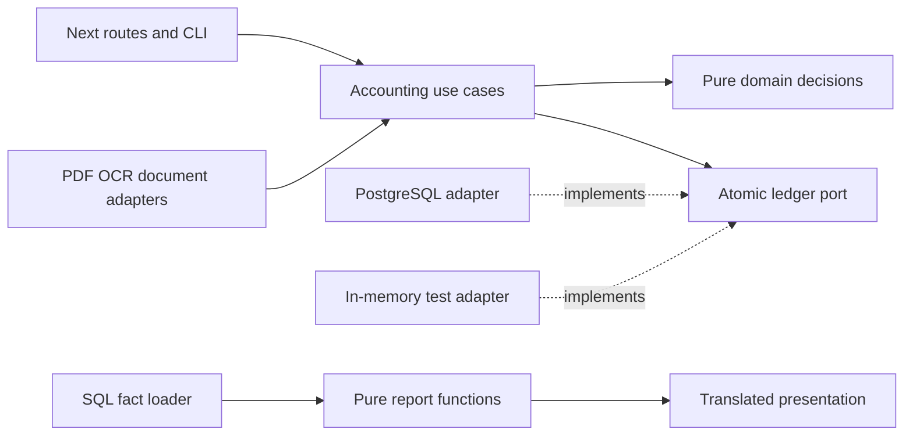

# Accounting Architecture Implementation Plan

Current execution and acceptance status: [Accounting migration implementation status](../../accounting/implementation-status.md). The planning-stage notices below record the original delivery; later user authorization permits implementation, while actual verification and live-cutover gates still apply.

> **Execution:** Follow the user-selected execution method and repository requirements. This plan does not require any additional skill. Steps use checkbox (`- [ ]`) syntax for tracking.

**Goal:** Preserve all current card and supermarket capabilities while connecting their evidence through a PostgreSQL-backed double-entry ledger.

**Architecture:** Keep one Next.js application and the existing local parsing processes. Put framework-free accounting rules and explicit use cases behind a small transaction port, implemented by PostgreSQL and an in-memory test adapter; keep SQL, PDFs, OCR, HTTP and translated presentation at the edges. Retain useful existing calculations without forcing their SQLite storage model into the ledger.

**Tech Stack:** Existing Next.js 16.3.3, React 19.2.8, TypeScript, Vitest, Python and MuPDF; PostgreSQL 18 for the isolated development/test target; node-postgres `pg` with parameterized SQL and explicit transactions. No ORM or additional application framework. Deployment compatibility is verified before choosing the host.

**Spec:** [Accepted requirements](../../accounting/requirements.md), [installment policy](../../accounting/installments.md), [domain glossary](../../../CONTEXT.md), [current-state index](../../current-state/README.md), [features](../../current-state/features.md), [calculations](../../current-state/behavior.md), [workflows](../../current-state/data-and-workflows.md), [preservation scenarios](../../current-state/preservation.md), [Q1–Q32](../../current-state/accounting-questions.md), [account proposal](../../proposals/personal-chart-of-accounts.md), [installment research](../../research/2026-10-25-installment-accounting.md), and [grouping research](../../research/2026-10-25-personal-finance-grouping.md).

## Global Constraints

- Current instruction: **DO NOT IMPLEMENT**. This delivery creates plans and the explicitly requested backup only. All implementation checkboxes below and in linked plans remain unchecked.
- “First migrate the existing card features into the accounting architecture. Add bank accounts and transfers after those features are migrated.”
- “Cover one person's finances with explicit distinct account/card identities.”
- “Support hosting and PostgreSQL. No application login is required for now.”
- “Preserve native ARS/USD amounts and available actual rate evidence. Balance native currencies independently in the initial card migration; keep IPC/MEP restatement as separate reporting lenses.”
- “Version source evidence and retain posted entries through explicit reversal/replacement with traceability.”
- “No period locks initially. New refunds and later charges retain their own evidenced event dates.” Corrections to original facts retain their original effective period and actual recording time.
- “Domestic supermarket purchases without sufficient item detail remain Unallocated purchases with amount, merchant evidence, and review status visible.”
- Preserve Q8 purchase-once recognition, Q9 unresolved payment-source clearing, Q17/Q21 purchases-abroad Travel convention, Q22 linked credits, Q25 validation, Q26 explicit correction scope, Q28 durable-purchase expense default, Q30 supported receipt-first posting, Q31 disclosed repayment attribution and Q32 verbatim custom labels.
- Preserve English default, Spanish choice, original evidence, exact-cent receipt admission, product identities, raw item data, pending corrections and prior review decisions. No external document OCR/translation service is authorized.
- Use one feature branch from `main`, with only direct same-release dependencies. Do not merge/rebase `dev` into it. Future authorized delivery uses PRs to both `dev` and `main`; this plan authorizes no commits, pushes, PRs, merges or deployment.
- Preserve existing uncommitted documentation and ignored personal data. At execution, recheck branch/state and read `web/AGENTS.md` plus the installed Next.js guides before changing Next code. Ask before creating an optional isolated worktree; do not create one during planning.
- Do not run imports, restores, migrations, or app initialization against the only data copy. Never call `getDb()` for read-only discovery: it can migrate/seed the SQLite file.

## Review Focus

1. Same-cycle renamed uploads and concurrent retries must not duplicate purchase debt or discard review/link history — Tasks 1, 4 and 5 have duplicate/conflicting-command and concurrent-import tests.
2. Two cards of the same brand and two genuine equal purchases must remain distinct; an `n/N` line cannot establish an invented original amount — Tasks 4 and 13 test identity ambiguity and partial-history openings.
3. Receipt-before-statement, one-cent mismatch and incorrect product identity must preserve evidence without another expense — Tasks 6–8 test the three arrival/correction paths and wrong-item review.
4. Corrected old purchases and later refunds must use different effective dates; corrections must also refresh debt attribution — Tasks 3 and 10 test original-period corrections, independent later credits and recalculated Q31 allocations.
5. Spanish switching or duplicate display names must not change journal amounts, filters or purpose debt, and a failed restore must not lose the last usable copy — Tasks 3, 12 and 15 pin these cases with label-identity and recovery tests plus UI checks.

---

## What has already been done

The user requested the operational backup before planning. On 2026-10-25:

- Created and verified a portable archive using the existing [backup CLI](../../../scripts/backup.py), without application initialization or a live-data restore.
- Copied the archive to `/Users/diegopronesti/Downloads/tarjetas-before-accounting-20261025T063526-ecc74daf/tarjetas-20261025T063526-ecc74daf.zip` and retained the original under ignored `backups/`.
- SHA-256: `d3b58f87dd6cba53ff8870025dcaf64b1d52d06f1f4619855637c2dd4f14ba7f`. The adjacent `.zip.sha256` file matches both copies.
- Archive: 120 files, 221,611,820 uncompressed bytes, 219,544,543 compressed bytes. It includes database, source PDFs/JSON, pending receipts/transcripts and reference data; it is not a source-code or credentials backup.
- Restored to a fresh temporary destination, checked SQLite integrity/foreign keys and all 12 relocated receipt PDF references, then removed that temporary copy. No restore was performed over live data.
- Private verification metadata: ignored `qa-output/accounting-planning/backup-verification.json`. This local path is evidence for this dated preflight, not a portable application dependency.

The SQLite backup API includes committed WAL content, but document files are copied separately. No application-wide writer pause was enforced for this planning backup. The archive is internally verified; Task 13/16 requires a fresh quiesced backup before drawing final cross-source/cutover conclusions. Downloads is a separate local copy, not an off-machine disaster-recovery service. The archive is private and unencrypted with owner-only file permissions.

## Plan structure and sequence

The subsystems are separated into four detailed plans. Follow the task numbers globally; each task is a reviewable increment with its own red/green cycle and rollback boundary.

| Order | Detailed plan | Tasks | Independently verifiable result |
| --- | --- | --- | --- |
| 1 | [Ledger foundation](2026-10-25-accounting-01-ledger.md) | 1–4 | A synthetic purchase can be posted, billed, repaid, corrected and traced to source revisions in an isolated PostgreSQL database |
| 2 | [Evidence and imports](2026-10-25-accounting-02-evidence.md) | 5–8 | Supported statements and receipts enter the same purchase model, with review, product detail and human decisions intact |
| 3 | [Reports and interface parity](2026-10-25-accounting-03-reports.md) | 9–12 | All existing reports and workflows can use the new backend in the isolated application; both languages work |
| 4 | [Reconstruction, hosting and cutover](2026-10-25-accounting-04-operations.md) | 13–16 | Rehearsed migration, hosted processing and backup recovery are proven before a concrete cutover decision |

Do not complete all schema work, then all backend work, then all UI work. Tasks 1–4 expose a small operator CLI through the actual domain/storage boundary; Tasks 5–8 exercise each import end to end in the isolated target; Tasks 9–12 move complete report/workflow groups. CLI increments are deliberate vertical slices, not a public journal-entry editor.

## File structure and responsibility map

Proposed paths below are implementation targets, not files created by this planning task. Paths relative to repository root; exact per-task lists are in the detailed plans.

| Path | Responsibility |
| --- | --- |
| `web/src/lib/accounting/model.ts` | Small native-currency journal, account, purchase, source-reference and command types |
| `web/src/lib/accounting/journal.ts` | Exact-money/date validation and per-currency balance rules |
| `web/src/lib/accounting/purchases.ts` | Purchase/billing/payment/credit decisions; no filesystem/SQL/UI imports |
| `web/src/lib/accounting/corrections.ts` | Explicit original-period reversal/replacement decisions |
| `web/src/lib/accounting/attribution.ts` | Deterministic Q31 billed-debt attribution with provenance |
| `web/src/lib/accounting/catalog.ts` | Chart/group definitions, primary purpose and label resolution |
| `web/src/lib/accounting/use-cases.ts` | Validated command orchestration against the injected transaction port |
| `web/src/lib/accounting/port.ts` | One atomic ledger boundary with exactly the operations used by the use cases |
| `web/src/lib/accounting/postgres.ts` | `pg` connection/client transaction, row mapping, immutable append, idempotency and a transaction-scoped writer lock |
| `web/src/lib/accounting/migrations/*.sql` | Ordered application-owned relational migrations; no automatic request-time migration |
| `web/src/lib/accounting/memory.ts` | Same transaction contract for deterministic use-case tests; never selected for live storage |
| `web/src/lib/accounting/test-support.ts` | Synthetic card/chart/receipt/statement builders and isolated PG test setup |
| `web/src/lib/accounting/evidence.ts` | Stable source/purchase identity, revision and matching decisions |
| `web/src/lib/accounting/statement-import.ts` | Existing parsed statement → evidence, purchases, bills/payments/review; no PDF parsing in the ledger |
| `web/src/lib/accounting/receipt-import.ts` | Verified receipt → retained evidence and supported purchase/allocation decisions |
| `web/src/lib/accounting/review.ts` | Rule, merchant, product and alert decision orchestration with retained history |
| `web/src/lib/accounting/read-model.ts` | Read-only reporting contract and explicit facts loaded by PostgreSQL/test readers for report functions and UI adapters |
| `web/src/lib/accounting/reports/{spending,timing,commitments,supermarket}.ts` | Focused pure report calculations using typed facts |
| `web/src/lib/backend.ts` | One explicit SQLite/PostgreSQL composition switch; never silent per-query fallback |
| `web/scripts/accounting.ts` | Operator migrate/demo/import/reconstruct/parity commands; no live default database |
| `web/scripts/accounting-restore-test.ts` | Restored PG/object-reference invariant check for an explicitly supplied isolated target |
| `scripts/accounting_backup.py` | PG dump + document/reference manifest backup/verify/restore; retains SQLite backup compatibility |
| Existing route/action/component files named in Tasks 5–12 | Thin input/presentation adapters; keep layout/navigation/controls where useful |

Only split a proposed module further when a task makes it hard to understand; do not create a class, repository interface or generic message bus for each row/entity. Keep the pure receipt verifier, product analytics, recurrence, forecast and valuation helpers where they already fit. Do not rewrite their algorithms solely to make directory names match a pattern.

## Dependency and transaction rules

Use synchronous function calls between modules and one relational transaction for a command. Initially serialize writes with one transaction-scoped PostgreSQL advisory lock for this personal installation; the memory adapter mirrors it. This lets receipt evidence without a known card commit atomically too. Deliberate simplicity ceiling: narrow to ordered card/source locks only if measured writer contention warrants the extra coordination. Source bytes are content-addressed before their database reference is committed; failed transactions may leave a harmless unreferenced immutable file, never a posted reference to a missing file. Source evidence, accepted decisions and journals are distinct records. An audit trail of immutable financial postings does not require an event-sourcing platform or a second write database.

Use a single acquired `pg` client for `BEGIN` through `COMMIT`/`ROLLBACK`, and parameterized values. These choices follow the [official transaction](https://node-postgres.com/features/transactions) and [query](https://node-postgres.com/features/queries) documentation checked on 2026-10-25. PostgreSQL [row constraints](https://www.postgresql.org/docs/18/ddl-constraints.html) are not cross-row journal-balance checks; Task 1 specifies an explicit posting finalization guard instead of pretending `CHECK` can sum other rows.

Exact accounting amounts are safe integer minor units in TypeScript, validated at every boundary, and `BIGINT` in PostgreSQL; input/output conversion rejects values outside `Number.MAX_SAFE_INTEGER`. Addition/subtraction checks safe-integer results. Existing decimal report/IPC/MEP calculations are separate and never write rounded results into the journal. Source decimals that cannot be converted exactly to cents enter review. The ES2017 target remains; do not introduce BigInt literal syntax or change target just to implement money.

## Working-state and rollback rule

Until the parity gate passes, the existing app remains the authoritative writer. New imports use the backup copy and an explicitly named isolated PostgreSQL target, not automatic dual writes. No background replication service or new persistent queue is required.

Task 9 introduces `TARJETAS_BACKEND=sqlite|postgres`, default `sqlite`, read once at the composition boundary. Development PostgreSQL mode is explicit; incomplete routes/actions expose a localized unavailable state rather than query SQLite as a fallback. Never combine live SQLite expenses with PostgreSQL liabilities into an apparently coherent report. All default SQLite routes remain usable after every increment. New-mode routes are checked as their complete slices land; production selection waits for Task 16.

Before any later live transition, take a fresh backup with writes paused. After PostgreSQL has accepted new live writes, reverting a flag to an older SQLite snapshot is **not** a lossless rollback: stop writes, retain both datasets/documents, export the intervening command/evidence set, and reconcile it before switching. No automatic destructive down-migration or journal deletion is part of a production rollback.

## Coverage ledger

Every capability remains in the first release; only banks/transfers and the explicit broader exclusions are deferred. IDs below are acceptance obligations, not claims of implementation or test results.

| Tasks | Features | Current scenarios | Agreed targets |
| --- | --- | --- | --- |
| 1–4 | F27, F32 foundation | P01, P02, P27 foundations | T06–T14, T16 |
| 5 | F27, F33 | P01, P02 | T06, T09–T12 |
| 6–7 | F24, F25, F29 | P20, P24 | T03–T05, T09, T15 |
| 8 | F02, F04, F05, F12, F26, F28 | P06, P07, P19, P23, P25 | T01–T08, T13–T14 |
| 9–10 | F03–F11, F13, F30 | P04, P05, P08–P12, P14 | T01–T04, T08–T10, T14, T16 |
| 11 | F01, F02, F12, F14–F20, F33 | P03, P13, P15–P19 | T02, T09–T12, T16 |
| 12 | F21–F26, F29–F31 | P20–P26 | T03–T05, T15, T17–T19 |
| 13 | F01–F33 reconstruction evidence | P01–P27 rehearsal | T01–T19 trial |
| 14 | F24, F27, F29, F31, F33 hosted processing | P01, P20, P25, P26 | T05, T15, T17, T19 |
| 15–16 | F01–F33 release gate, especially F32 | P01–P27 final proof | T01–T19 final proof |

The baseline explains known asymmetries (USD installment handling, ordinary peso reports omitting USD, forecast USD recurring coverage, brand-level schedules). Preserve them as explicit baseline fixtures until an accepted Q8/Q13/account-identity change supersedes the behavior. Record the exact before/after and accepted rationale in the parity report; a general permission to fix defects does not approve unrelated calculation changes. Do not hide differences by editing expected totals to match the new code.

| Accepted decisions | Owning implementation/gate |
| --- | --- |
| Q1–Q3 Scope, ownership and preservation | Global constraints; Tasks 4, 9–13 and 16 |
| Q4 Historical trial and opening balances | Tasks 13 and 16 |
| Q5–Q7 Currencies, PostgreSQL/hosting and evidence-to-payment trace | Tasks 1–2, 5–7, 10 and 14–16; actual bank funding stays in the later release |
| Q8–Q9 Installments and payment-source clearing | Tasks 1–2, 10–11 and 13 |
| Q10–Q12 New chart, conflict evidence and immutable corrections | Tasks 3–8 and 13 |
| Q13–Q15 Native balancing, private hosted OCR and no login | Tasks 1, 6, 10 and 14–16 |
| Q16–Q21 Chart detail, purpose groups, Travel and car purposes | Tasks 3, 7–8, 10 and 12; unsupported car financing remains reviewable |
| Q22–Q24 Credits, item allocations and Unallocated | Tasks 2, 7–8, 10–12 |
| Q25–Q27 Validated posting, correction scope and restated reports | Tasks 1, 3, 5–10 and 13 |
| Q28–Q31 Durable purchase default, dates, receipt-first and Q31 attribution | Tasks 2–3, 7, 10 and 13 |
| Q32 Multilingual custom naming | Tasks 3, 9 and 12; every changed feature's bilingual acceptance applies throughout |

## Verification and completion protocol

- [ ] Before each implementation task, recheck sources and accepted specs. Find the exact owning test/source paths; if prior work already supplies the slice, verify it instead of duplicating it.
- [ ] Run the task's red test, implement the smallest complete path, run the focused green test and any affected integration/UI check.
- [ ] From `web/`, run `npm test`, `npx tsc --noEmit` and `npm run build` after a code-bearing increment that affects them. Do not invent a lint script: none exists in the inspected package. Do not repeat successful checks on unchanged code.
- [ ] PostgreSQL checks run through the explicit `npm run test:accounting:pg` script introduced by Task 1. It fails when the opted-in test database is absent; default unit tests need no PostgreSQL, Docker, OCR or network.
- [ ] Use fixture transcript replay for offline receipt proof; run `npm run test:receipts` only for the separate real-OCR gate on its supported runtime. Run `python3 -m unittest discover -s scripts -p 'test_backup.py' -v` when touching backup compatibility and the new named PG backup tests in Task 15.
- [ ] Preserve a small verified diff per task. Commit only when separately authorized; when authorized, use explicit task paths and the task's suggested message. No `git add .` including unrelated documentation or private data.
- [ ] Before cutover, complete P01–P27 and T01–T19 on representative isolated evidence, including English/Spanish desktop/mobile workflows, recovery and a private data-parity report.

## Remaining gates, not missing product-policy answers

Historical cutover depends on the Task 13 reconstruction report. Uncertain car-payment components/taxes/credits depend on evidence and remain in review. Hosting/OCR/document placement depends on Task 14's measured result. Cross-currency bank settlement is deliberately outside this release. These gates must not be filled with guessed data, silently bypassed, or expanded into speculative architecture.

No implementation step, dependency installation, app test/build, PostgreSQL migration, commit or deployment was executed while writing this plan.
